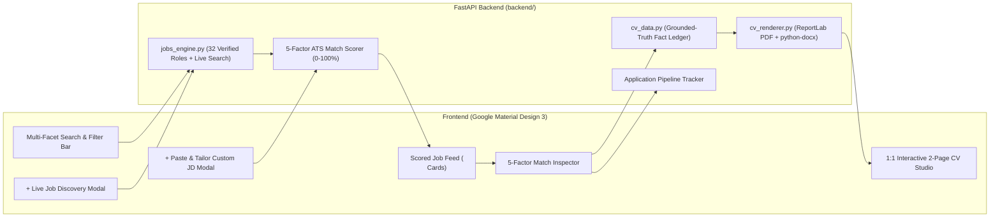

# AI Career Search, Match & Exact-Format ATS CV Studio

[](https://github.com/vinailead/ai-careerportal/actions)
[](./LICENSE)
[](https://www.python.org/)
[](https://m3.material.io/)

A full-stack **Job Search, Deterministic ATS Match Scoring, and 1:1 Grounded-Truth CV Tailoring Portal** engineered following **Google Material Design 3** principles and **GitHub Agentic Coding** standards.

Designed to help senior AI & Analytics leaders discover high-fit full-time roles across **Chennai**, **Bengaluru / Bangalore**, **Hyderabad**, and **True Global Remote (Work-from-Anywhere)** companies, score profile fit transparently, and generate tailored resumes in both **ATS-parseable PDF** and **Google Docs (`.docx`)** formats without losing 100% factual grounded truth.

---

## Key Capabilities

### 1. Curated & Live-Verified Job Discovery Engine
- **5 Target Role Tracks**:
  - `AI Strategy` (Enterprise AI Strategy, AI Value Realization, GenAI Transformation)
  - `Agentic AI` (Multi-Agent Workflows, Autonomous CX Containment, LangGraph Systems)
  - `Gen AI Leader` (GenAI Practice / Pod Leadership, Enterprise Gemini & LLM Delivery)
  - `AI Builder` (Principal / Lead Applied GenAI Architect, Forward-Deployed AI PM)
  - `Analytics` (Enterprise Portfolio Analytics, Credit Risk & Decision Science, CX Analytics)
- **Strict Geographic & Seniority Guardrails**:
  - **India Hubs**: `Chennai`, `Bengaluru / Bangalore`, and `Hyderabad`.
  - **Global Remote**: Strictly companies offering worldwide / India-eligible remote work (excluding US-only or EU-only geo-locked listings).
  - **Seniority Filter**: Automatically excludes `Director` and `VP` titles to focus on high-conversion `Senior Manager`, `Principal`, `AVP`, `Staff`, `Lead`, and `Manager` roles.

### 2. Zero-Hallucination Grounded-Truth CV Tailoring
- **Immutable Fact Ledger (`backend/cv_data.py`)**: Every generated resume is locked to verified career accomplishments (`$54.8M` cost-to-serve savings, `2.8M` annual call deflections, `100+` Agentic AI use cases projecting `$400M` ROI, pod of `10` Senior Consultants, `70%` cycle-time reduction via Google Gemini Enterprise, `$5B+` consumer credit portfolio).
- **Zero-Gap ATS Chronology**: Places `Independent AI Product Development (Jan 2026 – Present)` directly inside `PROFESSIONAL WORK EXPERIENCE` above `VERIZON | Chennai (Aug 2022 – Dec 2025)` and `CCLYTICX SERVICES PVT LTD | Chennai (Jun 2012 – Jul 2022)` so enterprise ATS parsers (Workday, Taleo, iCIMS, SuccessFactors) register continuous active experience.
- **Paste & Tailor Any Custom JD**: Paste any job description from Naukri, Indeed, LinkedIn, or a company career page to compute a live 5-factor Match Score and generate a tailored 2-page PDF and Google Doc (`.docx`) in seconds.

### 3. 1:1 Exact Visual & Typography Renderer (`PDF` + `.docx`)
- Replicates the exact 2-page layout, `Calibri` / `Calibri-Bold` typography, centered contact header with active hyperlinks (`mailto:`, LinkedIn, GitHub), full-width `0.71pt` black horizontal rules, hanging bullet indents, and right-aligned dates in both `.pdf` and `.docx` formats.

---

## System Architecture



---

## Repository Structure (GitHub & Agentic Coding Compliant)

```text
ai-career-portal/
├── .github/
│   ├── copilot-instructions.md          # GitHub Copilot Coding Agent instructions
│   ├── PULL_REQUEST_TEMPLATE.md         # PR verification checklist
│   ├── ISSUE_TEMPLATE/                  # Bug & Feature Request templates
│   └── workflows/ci.yml                 # GitHub Actions CI pipeline
├── AGENTS.md                            # Universal Agentic Coding Spec & Invariants
├── CLAUDE.md                            # Multi-agent pointer to AGENTS.md
├── backend/
│   ├── app.py                           # FastAPI REST server & Custom JD endpoint
│   ├── cv_data.py                       # Grounded-Truth Fact Ledger & 5 Master Archetypes
│   ├── cv_renderer.py                   # 1:1 Exact 2-Page PDF & Google Docs (.docx) renderer
│   └── jobs_engine.py                   # Curated jobs, 5-Factor Match Scorer & Live Discovery
├── frontend/
│   └── index.html                       # Google Material Design 3 Single-Page Application
├── config/
│   └── candidate_profile.example.json   # Configurable candidate profile template
├── tests/
│   └── test_portal.py                   # Pytest suite verifying invariants, rendering & API
├── pyproject.toml                       # PEP 621 package configuration
├── requirements.txt                     # Pinned Python dependencies
├── SECURITY.md                          # GitHub ToS & Responsible Data Policy
├── CONTRIBUTING.md                      # Contributor workflow
├── CODE_OF_CONDUCT.md                   # Contributor Covenant
└── LICENSE                              # MIT License
```

---

## Quickstart

### 1. Clone & Install Dependencies
```bash
git clone https://github.com/vinailead/ai-careerportal.git
cd ai-careerportal

# Using uv (recommended) or standard venv
uv venv .venv
uv pip install -r requirements.txt
```

### 2. Run the Verification Test Suite
```bash
./.venv/bin/pytest -v
```

### 3. Launch the Portal
```bash
./.venv/bin/uvicorn backend.app:app --host 127.0.0.1 --port 8765
```
Open **`http://127.0.0.1:8765`** in your browser.

---

## REST API Reference

| Method | Endpoint | Description |
| :--- | :--- | :--- |
| `GET` | `/api/health` | Health check, active counts, and policy status |
| `GET` | `/api/jobs` | Returns all curated & custom jobs sorted by 5-factor Match Score |
| `POST` | `/api/jobs/custom-tailor` | Scores any pasted Job Description and generates a tailored 2-page CV |
| `GET` | `/api/jobs/live-search` | Polite, user-initiated live discovery (excludes Director roles) |
| `GET` | `/api/master-variations` | Returns all 5 Master Role Variations + Baseline |
| `GET` | `/api/cv/job/{job_id}/{pdf\|docx}` | Downloads or previews the exact-format tailored CV for a job |
| `GET` | `/api/cv/master/{var_id}/{pdf\|docx}` | Downloads or previews a Master Role Variation CV |
| `POST` | `/api/tracker` | Updates application status (`Tailored`, `Saved`, `Applied`, `Interviewing`) |

---

## License

Released under the [MIT License](./LICENSE).
